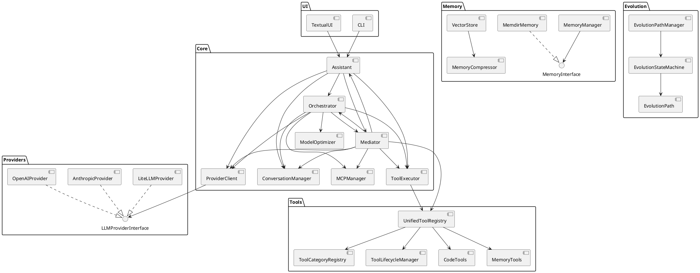
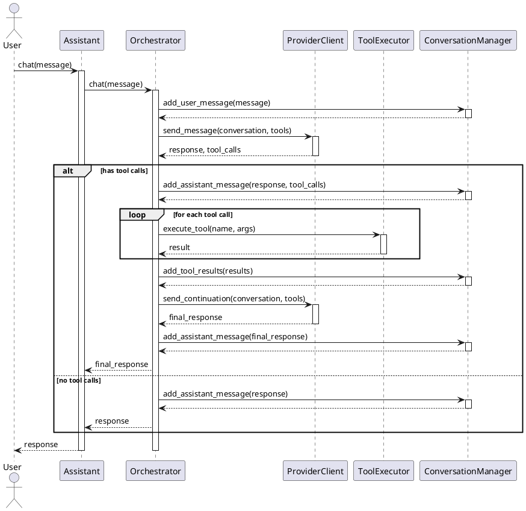
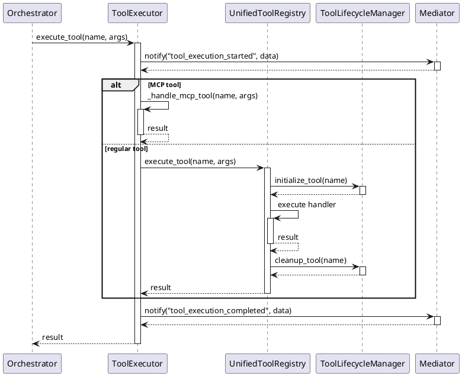

# Fei 3.0 Architecture Documentation

## Overview

Fei 3.0 is a modular, extensible AI assistant system designed for code manipulation, memory management, and tool execution. The architecture follows a component-based approach with clear separation of concerns, making it easy to extend and maintain.

## Core Architecture

The Fei 3.0 architecture is built around several key components:

1. **Assistant**: The main entry point for interacting with the system
2. **Orchestrator**: Coordinates the high-level flow of the assistant
3. **Provider Client**: Handles communication with LLM providers
4. **Tool Executor**: Manages tool execution
5. **Conversation Manager**: Manages conversation state
6. **Memory System**: Provides persistent storage for information
7. **Evolution System**: Manages the assistant's evolution over time
8. **Mediator**: Facilitates communication between components

### Component Diagram



## Component Details

### Assistant

The `Assistant` class serves as the main entry point for interacting with the Fei system. It delegates to specialized components for specific functionality.

```python
class Assistant:
    def __init__(
        self, 
        config: Optional[Config] = None,
        api_key: Optional[str] = None,
        model: Optional[str] = None,
        provider: Optional[str] = None,
        tool_registry: Optional[UnifiedToolRegistry] = None,
        mcp_manager: Optional[MCPManager] = None,
        consent_ui_provider: Optional[ConsentUiProvider] = None
    ):
        # Initialize components
        self.mediator = Mediator()
        self.provider_client = ProviderClient(...)
        self.model_optimizer = ModelOptimizer(...)
        self.mcp_manager = mcp_manager or MCPManager(...)
        self.tool_registry = tool_registry or UnifiedToolRegistry(...)
        self.tool_executor = ToolExecutor(...)
        self.conversation_manager = ConversationManager(...)
        self.orchestrator = AssistantOrchestrator(...)
        
    async def chat(self, message: str, system_prompt: Optional[str] = None) -> str:
        return await self.orchestrator.chat(message, system_prompt)
```

### Orchestrator

The `AssistantOrchestrator` class coordinates the high-level flow of the assistant, delegating to specialized components.

```python
class AssistantOrchestrator:
    def __init__(
        self, 
        config: Optional[Config] = None,
        provider_client: Optional[ProviderClient] = None,
        tool_executor: Optional[ToolExecutor] = None,
        conversation_manager: Optional[ConversationManager] = None,
        model_optimizer: Optional[ModelOptimizer] = None,
        mcp_manager: Optional[MCPManager] = None,
        mediator: Optional[Mediator] = None,
        consent_ui_provider: Optional[ConsentUiProvider] = None
    ):
        # Initialize components
        
    async def chat(self, message: str, system_prompt: Optional[str] = None) -> str:
        # Process user message
        # Send to LLM
        # Execute tools if needed
        # Return response
```

### Provider Client

The `ProviderClient` class handles communication with LLM providers.

```python
class ProviderClient:
    def __init__(
        self, 
        config: Config,
        mediator: Optional[Mediator] = None,
        provider: Optional[str] = None,
        api_key: Optional[str] = None,
        model: Optional[str] = None
    ):
        # Initialize provider settings
        
    async def send_message(
        self, 
        messages: List[Dict[str, Any]], 
        system_prompt: Optional[str] = None,
        tools: Optional[List[Dict[str, Any]]] = None
    ) -> Tuple[str, List[Dict[str, Any]]]:
        # Send message to LLM
        # Return response and tool calls
```

### Tool Executor

The `ToolExecutor` class manages tool execution.

```python
class ToolExecutor:
    def __init__(
        self,
        provider: str,
        mcp_manager: Optional[MCPManager] = None,
        mediator: Optional[Mediator] = None,
        tool_registry: Optional[ToolRegistry] = None
    ):
        # Initialize tool execution settings
        
    async def execute_tool(self, tool_name: str, tool_args: Dict[str, Any]) -> Dict[str, Any]:
        # Execute tool
        # Return result
```

### Unified Tool Registry

The `UnifiedToolRegistry` class provides a unified interface for tool registration and execution.

```python
class UnifiedToolRegistry:
    def __init__(self, mediator: Optional[Mediator] = None):
        # Initialize registry
        self.tools: Dict[str, Tool] = {}
        self.category_registry = ToolCategoryRegistry()
        self.lifecycle_manager = ToolLifecycleManager()
        
    def register_tool(
        self, 
        name: str, 
        description: str, 
        input_schema: Dict[str, Any], 
        handler_func: AnyToolHandlerType,
        tags: Optional[List[str]] = None,
        category: Optional[str] = None,
        initializer: Optional[Callable] = None,
        cleanup: Optional[Callable] = None,
        version: str = "1.0.0",
        metadata: Optional[Dict[str, Any]] = None
    ) -> None:
        # Register tool
        
    async def execute_tool(self, name: str, arguments: Dict[str, Any]) -> Dict[str, Any]:
        # Execute tool
        # Return result
```

### Memory System

The memory system provides persistent storage for information with multiple backends.

#### Memory Interface

```python
class MemoryInterface(ABC):
    @abstractmethod
    async def setup(self, config: Dict[str, Any]) -> None:
        pass
        
    @abstractmethod
    async def search(self, query: str, limit: int = 10) -> List[Dict[str, Any]]:
        pass
        
    @abstractmethod
    async def create(self, content: str, metadata: Optional[Dict[str, Any]] = None) -> Dict[str, Any]:
        pass
        
    # Other memory operations
```

#### Vector Store

```python
class VectorStore:
    def __init__(
        self,
        embedding_provider: Optional[EmbeddingProvider] = None,
        config: Optional[Config] = None,
        vector_dimension: int = 1536,
        similarity_threshold: float = 0.7
    ):
        # Initialize vector store
        
    async def add_memory(
        self,
        memory_id: str,
        content: str,
        metadata: Optional[Dict[str, Any]] = None
    ) -> bool:
        # Add memory to vector store
        
    async def search(
        self,
        query: str,
        limit: int = 10,
        threshold: Optional[float] = None
    ) -> List[Dict[str, Any]]:
        # Search for memories
        # Return results
```

### Evolution System

The evolution system manages the assistant's evolution over time.

#### Evolution State Machine

```python
class EvolutionStateMachine:
    def __init__(self, config: Optional[Config] = None):
        # Initialize state machine
        
    def get_current_state(self) -> EvolutionState:
        # Get current state
        
    def transition_to_stage(
        self,
        target_stage_id: str,
        metadata: Optional[Dict[str, Any]] = None
    ) -> bool:
        # Transition to new stage
        # Return success
```

#### Evolution Path

```python
class EvolutionPath:
    def __init__(
        self,
        path_id: str,
        name: str,
        description: str,
        stages: Dict[str, Dict[str, Any]],
        transitions: Dict[str, List[str]]
    ):
        # Initialize path
        
    def get_stage(self, stage_id: str) -> Optional[Dict[str, Any]]:
        # Get stage
        
    def can_transition(self, from_stage: str, to_stage: str) -> bool:
        # Check if transition is allowed
```

### Mediator

The `Mediator` class facilitates communication between components without direct dependencies.

```python
class Mediator:
    def __init__(self):
        # Initialize mediator
        self.components: Dict[str, Any] = {}
        self.event_handlers: Dict[str, List[Callable[[Dict[str, Any]], None]]] = {}
        
    def register_component(self, name: str, component: Any) -> None:
        # Register component
        
    def register_handler(self, event_name: str, handler: Callable[[Dict[str, Any]], None]) -> None:
        # Register event handler
        
    def notify(self, event_name: str, data: Dict[str, Any]) -> None:
        # Notify handlers of event
```

## Sequence Diagrams

### Chat Sequence



### Tool Execution Sequence



## Design Patterns

The Fei 3.0 architecture employs several design patterns:

1. **Mediator Pattern**: The `Mediator` class facilitates communication between components without direct dependencies.
2. **Factory Pattern**: The `ProviderFactory` and `MemoryFactory` classes create instances of providers and memory systems.
3. **Strategy Pattern**: Different provider and memory implementations follow the strategy pattern.
4. **Command Pattern**: Tool execution follows the command pattern.
5. **Observer Pattern**: Components can register for events through the mediator.
6. **Decorator Pattern**: Tools can be decorated with additional functionality.
7. **Singleton Pattern**: Configuration is effectively a singleton.

## Extensibility

The Fei 3.0 architecture is designed for extensibility:

1. **New Providers**: Implement the `LLMProviderInterface` and register with the `ProviderFactory`.
2. **New Tools**: Register tools with the `UnifiedToolRegistry`.
3. **New Memory Systems**: Implement the `MemoryInterface` and register with the `MemoryFactory`.
4. **New Evolution Paths**: Create new paths with the `EvolutionPathManager`.
5. **New UI Interfaces**: Create new interfaces that use the `Assistant` class.

## Conclusion

The Fei 3.0 architecture provides a robust, modular, and extensible foundation for building AI assistant systems. The clear separation of concerns and use of design patterns make it easy to extend and maintain.
